# Multi-region hotel booking on AWS, with a Databricks lakehouse

Hotel bookings are accepted in two AWS regions at once, and no room-night is ever sold twice:
1000 concurrent attempts at the last room-night, from k6 in three regions, give exactly one `201`
and 999 `409`. Every booking change flows through a change stream into a Databricks lakehouse:
bronze keeps what landed, silver deduplicates and restores order across regions, gold computes
occupancy, revenue and contention. Replaying every event twice, out of order, leaves silver and
gold byte-for-byte unchanged.

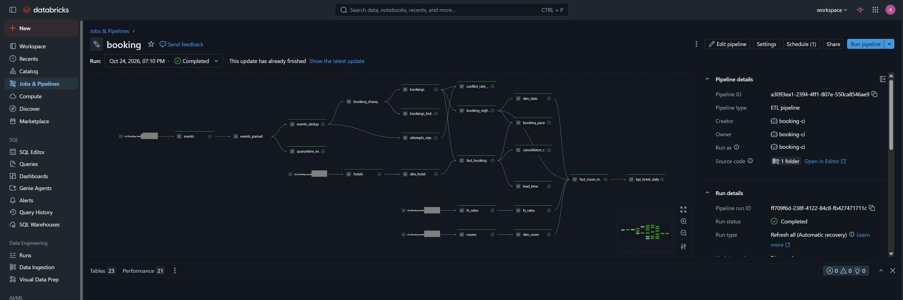

*The Lakeflow Declarative Pipeline `booking` after a cloud run: four Auto Loader sources from S3,
then bronze (`events`, `hotels`, `rooms`, `fx_rates`), silver (`events_dedup`, `bookings`,
`booking_nights`, `quarantine_events`, dimensions) and gold (`fact_booking`, `fact_room_night`,
`kpi_hotel_daily` and the demand marts): 23 tables in Unity Catalog under `booking`.*

The whole stack comes up with `make up` and goes away with `make down`. An AWS session costs
cents. The brief is [`TASK.md`](TASK.md).

### The 3-minute tour

https://github.com/user-attachments/assets/dbb5a559-456f-4d31-9811-6a8721cd1c02

| | |
|---|---|
| Transactional | API Gateway + Lambda (Python 3.13) in us-east-1 and us-east-2, DynamoDB global tables with multi-region strong consistency (MRSC), a Step Functions saga |
| Analytical | DynamoDB Streams -> Kinesis -> Firehose -> S3 -> Auto Loader -> Lakeflow Declarative Pipelines (medallion, AUTO CDC, expectations) -> Unity Catalog -> AI/BI dashboard |
| Platform | Terraform + Terragrunt over four regions, GitHub Actions with OIDC, Databricks Asset Bundles, one dev container for CI and contributors |

## Status

| Part | Evidence |
|---|---|
| Booking core, saga, events, PII residency | 40 integration tests on DynamoDB Local, green in CI |
| Contention proof in the cloud | [run 1](docs/runs/2026-10-22-run-1/) and [run 2](docs/runs/2026-10-24-run-2/k6.json): 1000 attempts, 1 `201`, 999 `409`, 0 errors, no overlapping bookings |
| Lakehouse in the cloud | [run 2](docs/runs/2026-10-24-run-2/lakehouse.json): every job check passed. [Run 5](docs/runs/2026-10-24-run-5/): the checks, the data-quality table and the replay passed |
| Exactly once, replayed | [run 5 replay.json](docs/runs/2026-10-24-run-5/replay.json): 9264 duplicate events sent, 0 duplicates in silver, the fingerprints of five silver and gold tables unchanged |
| Demo video | [the 3-minute tour](#the-3-minute-tour); the file is [`docs/video/zero-double-bookings-compressed.mp4`](docs/video/zero-double-bookings-compressed.mp4) |
| Cloud resources | all torn down on 2026-10-25, the persistent ones included (`make destroy-persistent`); the screenshots, run artifacts and the video are the record |

## Architecture

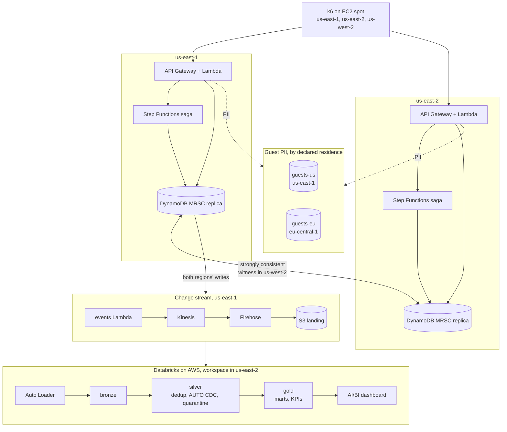

The booking store is four DynamoDB tables replicated with strong consistency between us-east-1 and
us-east-2, with us-west-2 as witness. Guests' PII never enters it: it lives in a single-region table
chosen by the guest's jurisdiction. The stream exists only in us-east-1, where the tables were
created, and carries the writes of both regions. The Databricks workspace runs in us-east-2 and
reads and writes S3 buckets in us-east-1 through Unity Catalog external locations.

### Why these services

| Need | Chosen | Instead of | Why |
|---|---|---|---|
| Writes accepted in two regions, never two winners for one room-night | DynamoDB global tables with MRSC | Aurora DSQL; DynamoDB global tables with eventual consistency; Aurora Global Database | DSQL, the first choice, could not be created on the account ([ADR 2](docs/adr/0002-dynamodb-mrsc-booking-store.md)). Eventually consistent global tables resolve conflicts by last writer wins, which would confirm two guests. Aurora Global Database has one writer region. |
| An API that costs nothing between sessions | API Gateway HTTP API + Lambda | ECS or EKS services | No idle cost, and `make up` / `make down` stay minutes long. |
| A hold that expires unless payment arrives | Step Functions saga | DynamoDB TTL; a queue with delayed messages | MRSC tables have no TTL. The saga makes the race between payment and timer explicit, retried and visible per execution. |
| Every change, from both regions, into files | DynamoDB Streams -> Lambda -> Kinesis -> Firehose -> S3 | Lambda writing S3 directly | The Lambda turns a stream record into an envelope with a stable `event_id`. Kinesis keeps the events for a day for any later consumer. Firehose batches them into compressed files partitioned by region and date, so Auto Loader reads few files, not one per booking. |
| Ingest, deduplicate, order, check | Auto Loader + Lakeflow Declarative Pipelines, serverless, triggered | Hand-written Structured Streaming jobs; a continuous pipeline | Expectations, quarantine and `AUTO CDC ... SEQUENCE BY` are declared, not coded. A triggered serverless pipeline costs nothing between runs. |
| Governance and BI | Unity Catalog + AI/BI dashboard | A separate BI tool | Grants, lineage and the dashboard sit next to the tables, and ship in the same bundle. |
| Real cross-region contention | k6 on EC2 spot in three regions | A Lambda-based load generator | Lambda concurrency on the account was 10 per region; the generator would have throttled itself. Spot instances cost cents for the minutes they live. |

## Following one booking through the system

### 1. The request: API Gateway and Lambda, in two regions

Each region has the same HTTP API: `POST /bookings`, `POST /bookings/{id}/cancel`, `POST /guests`
and `GET /availability`, all served by the `booking-api` Lambda. Three more run the
saga's steps, and `booking-events` reads the change stream.
The screenshots were taken before the search was dropped ([ADR 6](docs/adr/0006-semantic-search-dropped.md)),
so they still show its `GET /search` route and its Terraform state.

<p>
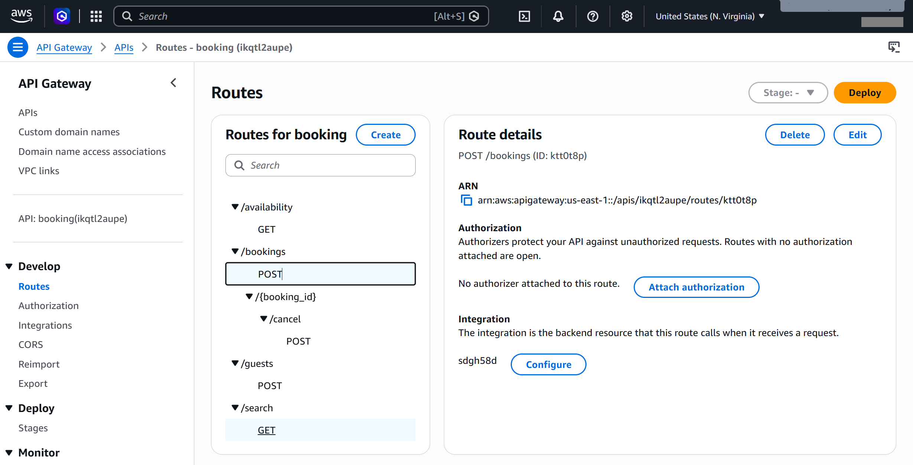
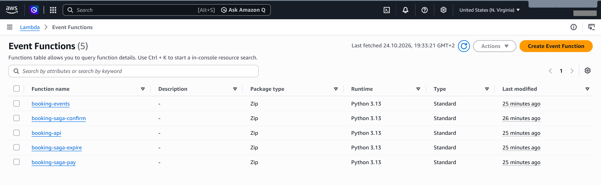
</p>

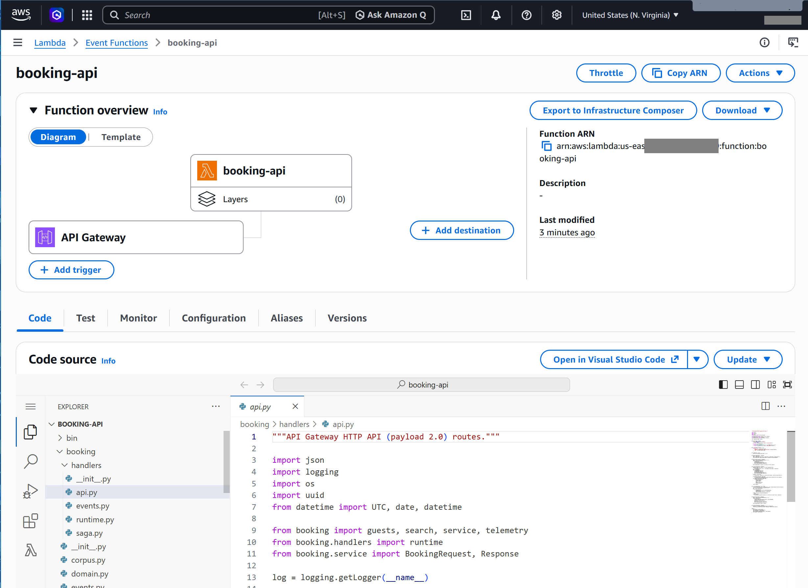

### 2. The store: one item per taken room-night

One item per taken room-night, `room_night = <room_id>#<night>`, written with a conditional
`PutItem` (`attribute_not_exists(room_night)`, or the holder's hold expired more than 5 s ago).
With strong consistency across regions, two writers of the same key cannot both succeed; the loser
gets a failed condition, or a `ReplicatedWriteConflictException` that is retried with exponential
backoff and full jitter. A multi-night stay claims its nights in date order and releases them if
any night is taken ([`src/booking/service.py`](src/booking/service.py)).

The same MRSC table answers in N. Virginia and in Ohio. Below, the race table of the cross-region
test after four sessions: each race left one item, its winner's booking.

<p>
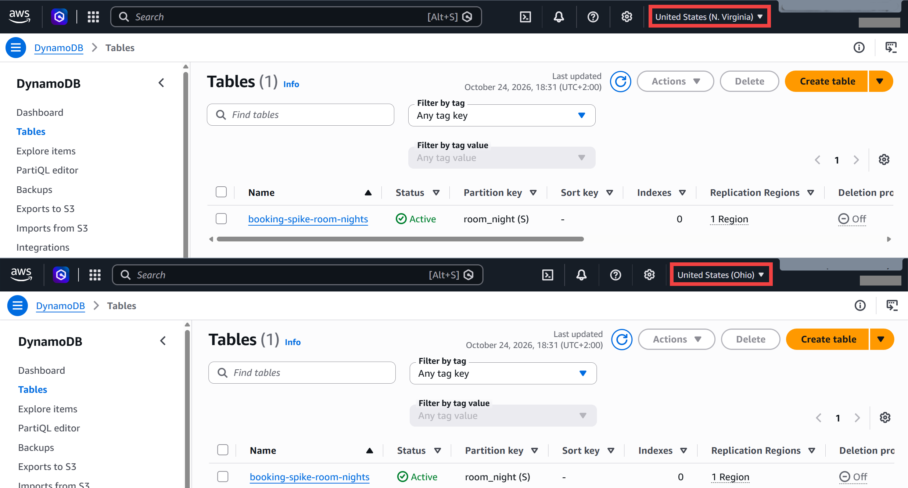
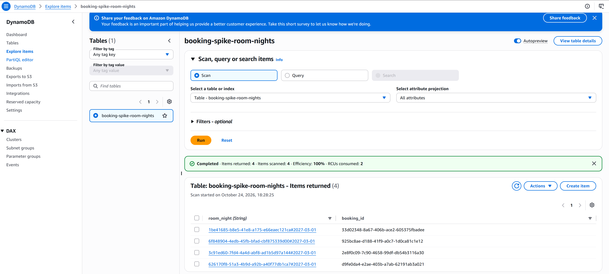
</p>

The invariant check does not trust the claims: it scans the bookings themselves for two live
bookings of one room with overlapping stays ([`booking.store.violations`](src/booking/store.py)).

| Claim | Local evidence | Cloud evidence |
|---|---|---|
| 1000 concurrent bookings of one room-night, one winner | [`test_concurrent_same_room_night`](tests/integration/test_booking.py) | [run 2 k6.json](docs/runs/2026-10-24-run-2/k6.json): created 1, conflict 999, from three regions to both APIs |
| No overlapping live bookings afterwards | [`test_invariant_flags_overlap`](tests/integration/test_booking.py) | [run 5 invariant.json](docs/runs/2026-10-24-run-5/invariant.json): no violations among 171 bookings |
| Concurrent conditional writes from both regions: one wins, both replicas agree | [`test_mrsc_race`](tests/integration/test_mrsc_race.py) | [run 5 mrsc.json](docs/runs/2026-10-24-run-5/mrsc.json): 100 attempts, 1 won, both regions see the same holder |
| Same `Idempotency-Key` replays, never books twice | [`test_idempotent_replay`](tests/integration/test_booking.py) | [run 5 traffic.json](docs/runs/2026-10-24-run-5/traffic.json): replay `200` |

Negative control: with the claim condition removed, `test_concurrent_same_room_night` produces many
`201`s and fails.

**First commit, not first click.** The guarantee is "first write wins", not "first click wins".
Two regions share no clock that orders clicks, so a first-click rule could be neither enforced nor
checked; the order of conditional writes can be.

**The last room from two regions.** DynamoDB MRSC has no transactions, so a multi-night booking
cannot claim its nights atomically. The loser of a race may hold its earlier nights for
milliseconds before it releases them; nobody is ever confirmed on a night someone else holds.

### 3. The hold: a Step Functions saga

A booking is held as `pending` while the saga races a simulated payment against a timer. Every
write is conditioned on the booking's `version`. A payment that arrives after the hold expired, or
after another booking took over a night, leaves the booking `expired` and emits `PaymentRefunded`
([`test_payment_after_expiry`](tests/integration/test_saga.py),
[`test_payment_after_takeover_is_refunded`](tests/integration/test_saga.py)). Confirmation first
removes the claims' expiry, then confirms the booking; a crash in between leaves the room blocked,
never sold twice.

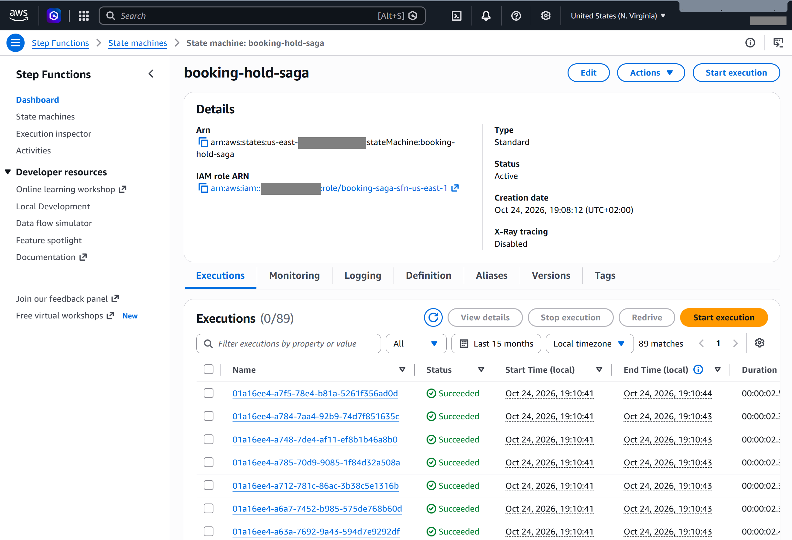

### 4. The proof under load: k6 from three regions

`make demo` starts one spot instance in each of us-east-1, us-east-2 and us-west-2. All three wait
for one shared instant, then send 1000 attempts at the same room-night to both regional APIs, and
write their summaries to S3.

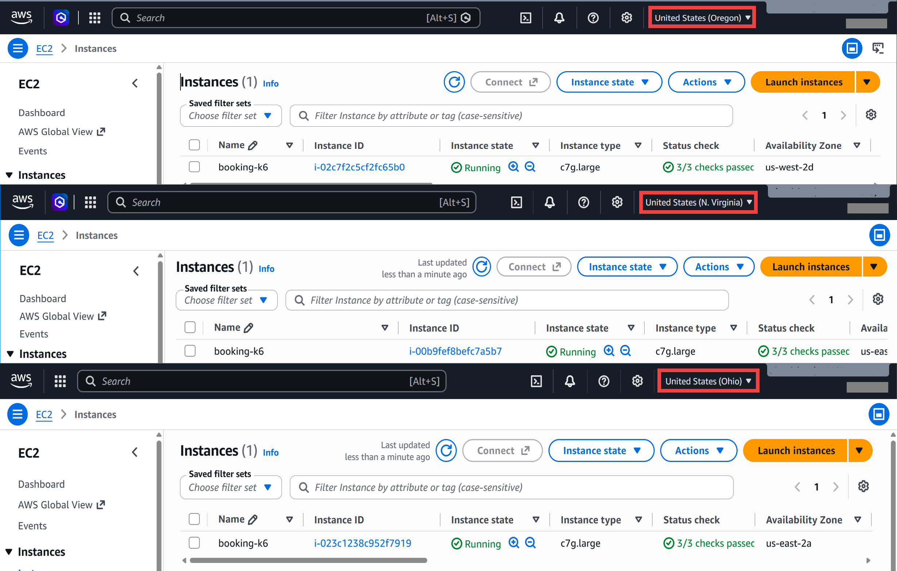

<p>
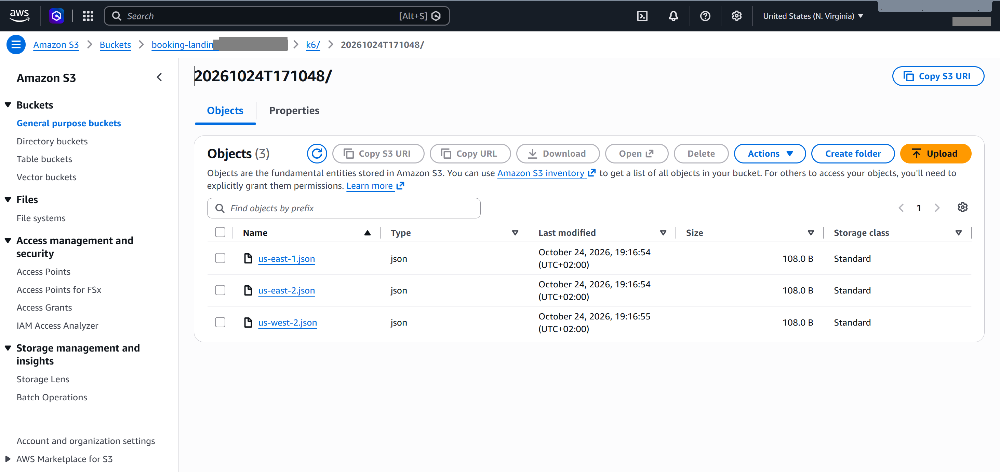
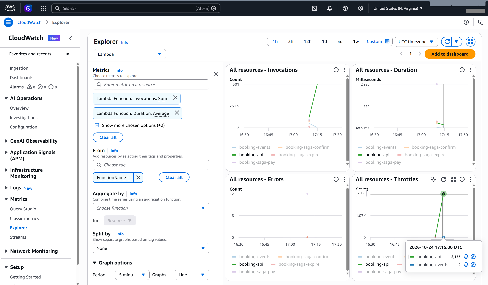
</p>

Lambda concurrency on the account is low (10 per region at first, 40 now), so most attempts are
throttled first. k6 resends a throttled attempt with the same `Idempotency-Key`, which is why
CloudWatch shows 2133 throttles in one five-minute window and the store still sees each attempt
exactly once.

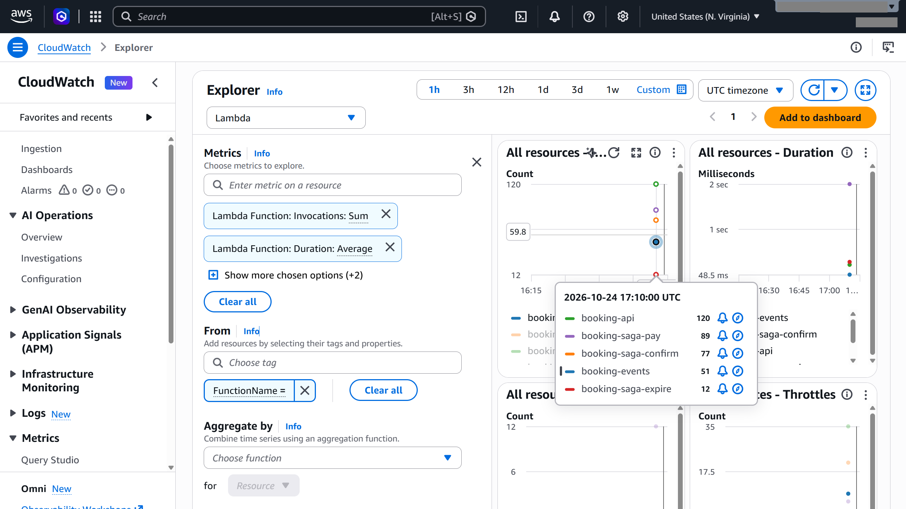

### 5. The change stream: Kinesis, Firehose, S3

Each change of a booking becomes one envelope with a name-based id: `uuid5(booking_id, version)`
for a state event, `uuid5(booking_id)` for the refund
([`src/booking/events.py`](src/booking/events.py)). Delivery is at least once; a redelivered change
repeats its id. Firehose partitions the files by the region that accepted the write:
`events/region=<region>/dt=<date>/`.

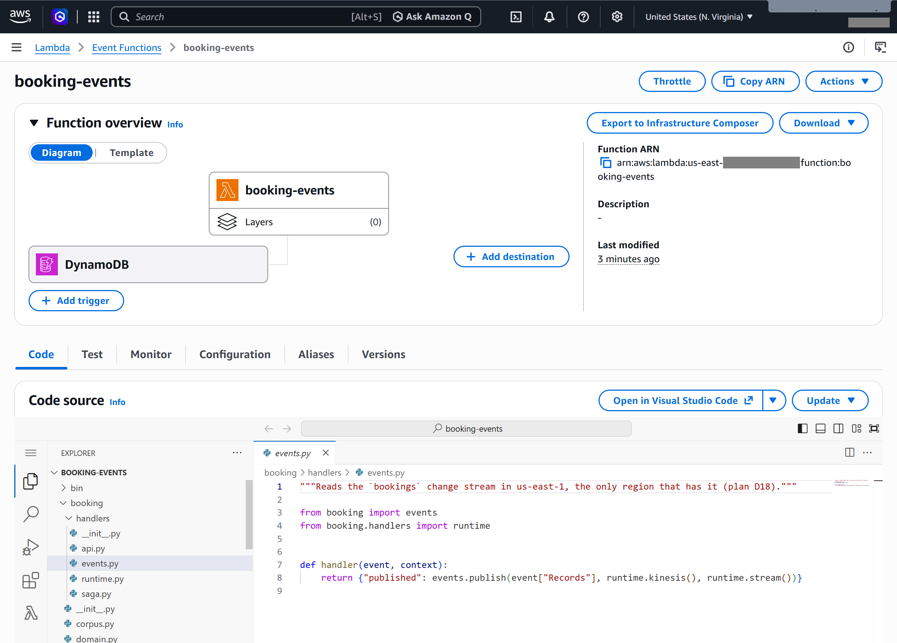

<p>
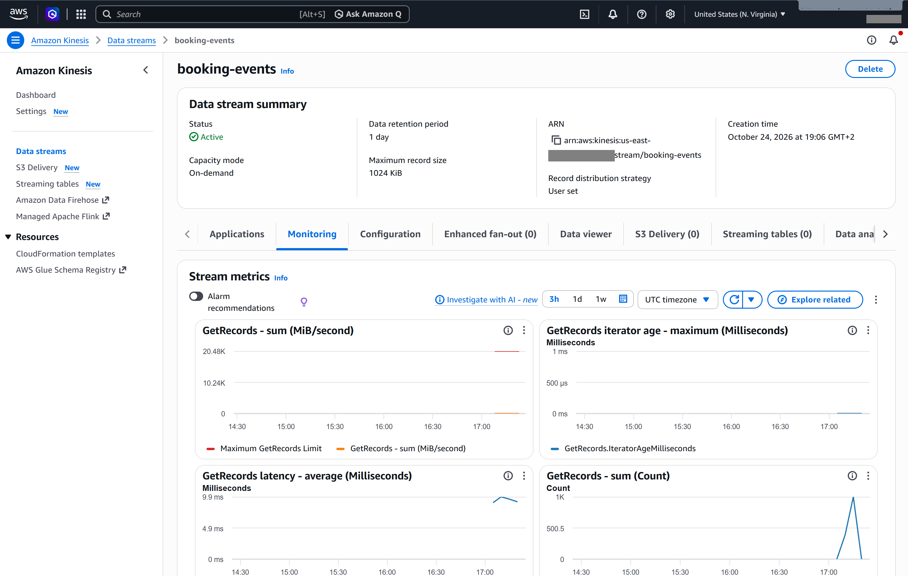
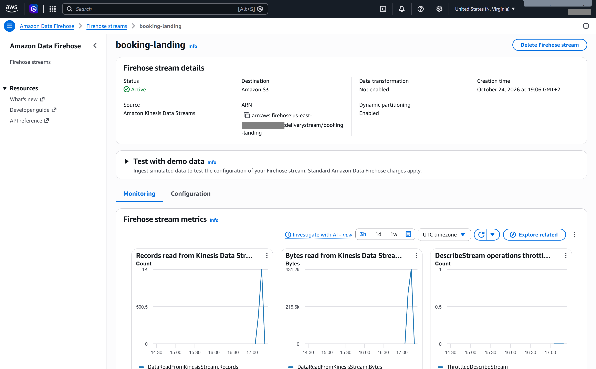
</p>

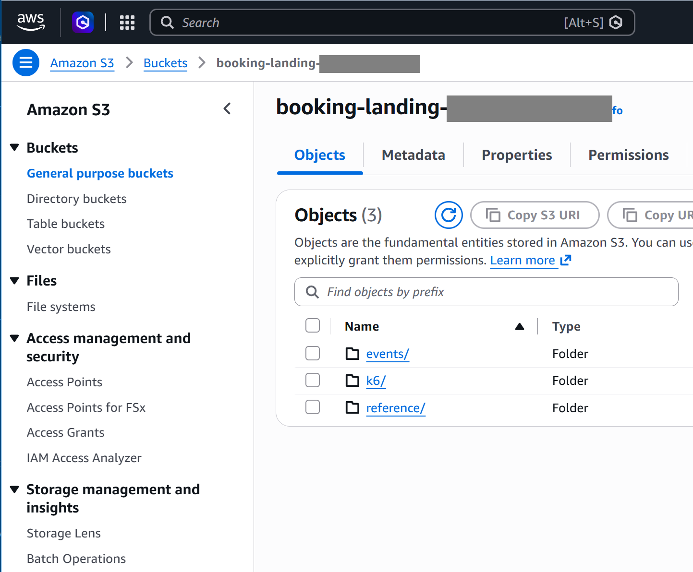

### 6. The lakehouse: bronze, silver, gold

The Lakeflow Job `booking-refresh` runs on file arrival in `events/`, at most every 5 minutes. It
runs the pipeline, then four SQL checks and the data-quality table, then refreshes the dashboard
([`databricks/databricks.yml`](databricks/databricks.yml)).

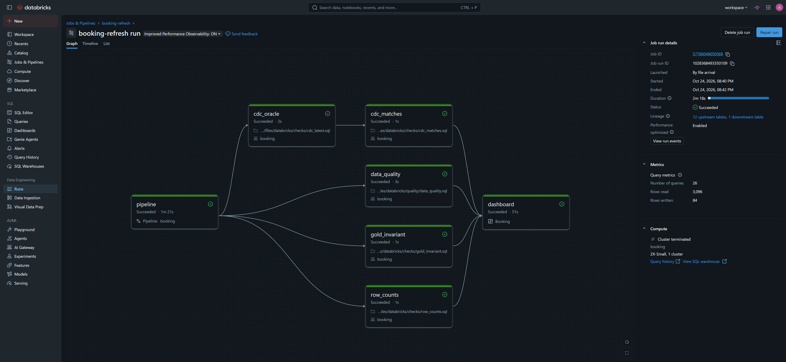

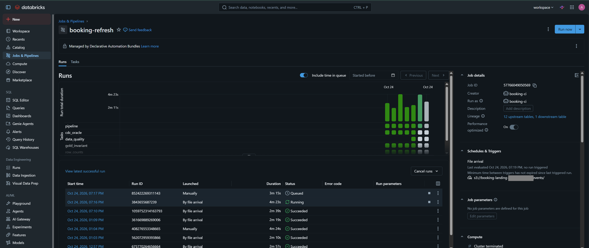

- **bronze**: Auto Loader, append only. Expectations record, never drop: bronze is the raw record.
- **silver**: one row per `event_id`
  ([`test_dedup_collapses_duplicates`](tests/lakehouse/test_silver.py)), then
  `AUTO CDC ... SEQUENCE BY version` restores per-booking order across regions
  ([`test_cdc_oracle_out_of_order`](tests/lakehouse/test_gold.py)). Rows that break a rule leave
  the marts and stay in `quarantine_events` with the rule they broke. `bookings_history` keeps every
  version (SCD type 2):

  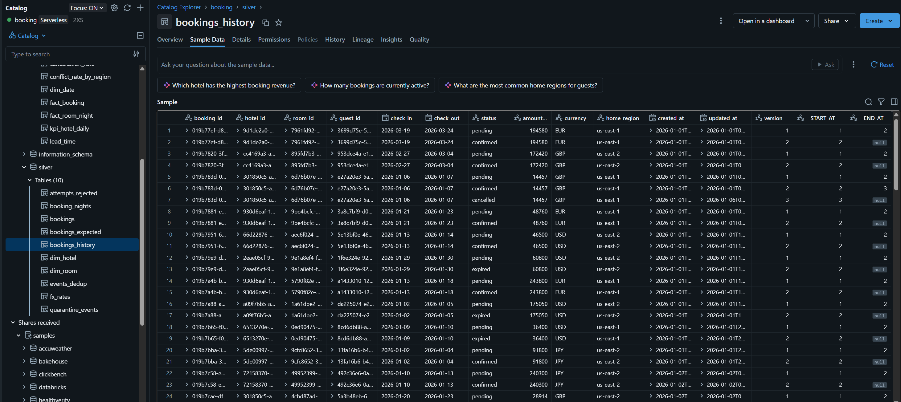

- **gold**: room-night grain with occupancy, ADR, RevPAR, booking pace, lead time, cancellation rate
  and conflict rate by region ([`tests/lakehouse/test_gold.py`](tests/lakehouse/test_gold.py)).
  The marts carry the invariant themselves: `fact_room_night` fails the update if any room-night
  has two confirmed bookings.

  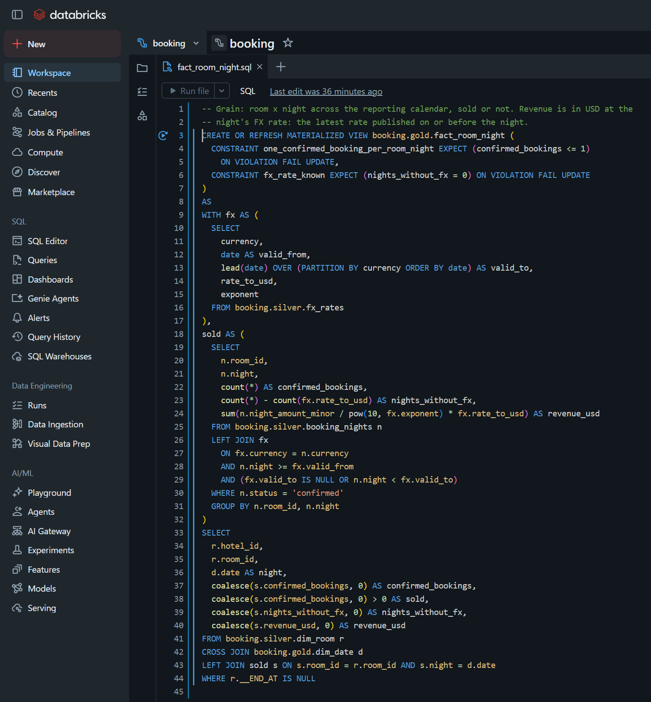

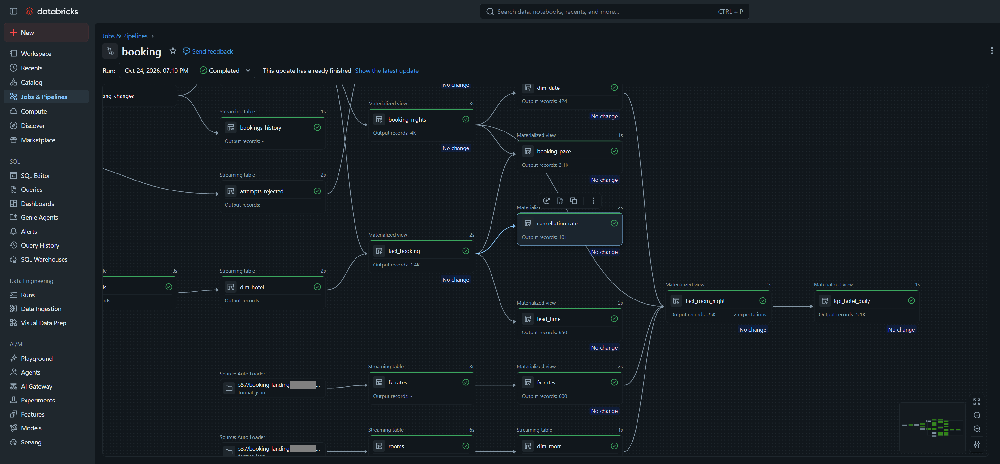

Money is stored in minor units with the hotel's currency and converted to USD at the night's rate;
nights are hotel-local dates, and lead time is computed in the hotel's time zone
([`test_fx_per_night`](tests/lakehouse/test_gold.py),
[`test_lead_time_across_midnight`](tests/lakehouse/test_gold.py)).

#### Checks that do not trust the pipeline

`cdc_matches` compares `silver.bookings`, which AUTO CDC builds, with `bookings_expected`, an
independent "latest version per booking" query. Any difference fails the job. `gold_invariant`
repeats the double-booking check in SQL, and `row_counts` compares the lakehouse with the store.

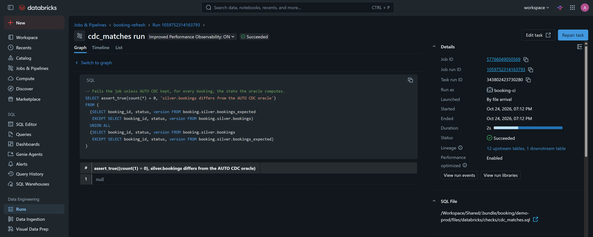

#### Exactly once, proven by a replay

After the first refresh, the demo reads every event file back from the landing bucket and writes
each event again, twice, in shuffled order, under `events/region=<region>/replay/<id>/`. Then it
runs the job again and compares ([`ops/demo.py`](ops/demo.py), `replay`):

| | Run 5 |
|---|---|
| Original events in bronze | 4632 |
| Replayed copies sent and landed in bronze | 9264 |
| Duplicate `event_id`s in silver | 0 |
| `count` and `sum(xxhash64(...))` of `silver.events_dedup`, `silver.bookings`, `gold.fact_booking`, `gold.fact_room_night`, `gold.conflict_rate_by_region` | identical before and after |

Deduplication is `dropDuplicates(["event_id"])` with no watermark, so its state never forgets an
id; AUTO CDC then makes the order of arrival irrelevant.

#### Data quality from the event log

`booking.gold.data_quality` unpacks the pipeline's event log: rows passed and failed per
expectation, per update ([`databricks/quality/data_quality.sql`](databricks/quality/data_quality.sql)).

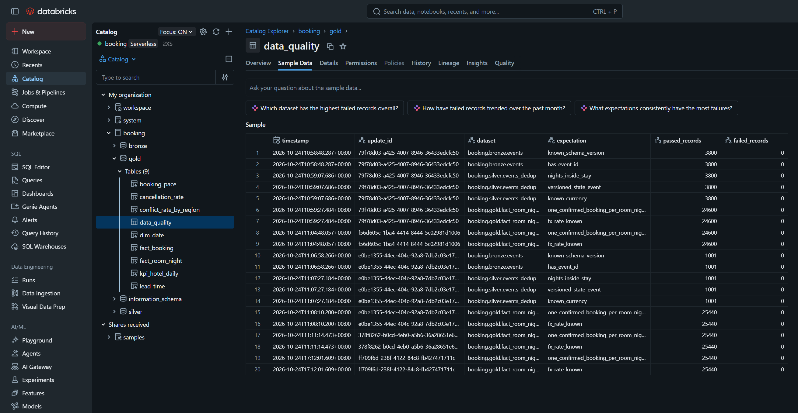

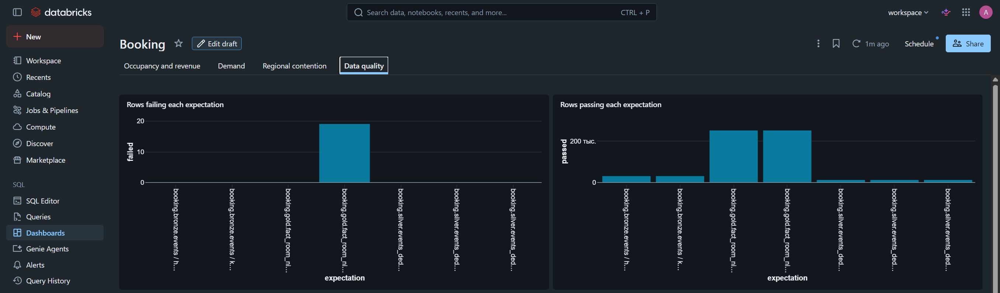

The failed rows on the left chart are real. In run 3 the tables still held run 2's bookings, and
the seeded traffic booked the same room-nights again in a fresh store: `fact_room_night` saw two
confirmed bookings on one night and stopped every update. The expectation did its job across
sessions, not within one; [#20](https://github.com/AlexBormotov/databricks-multi-region-booking-aws/pull/20)
now resets the tables when a session deploys the bundle.

#### Storage

The catalog keeps its managed tables in a bucket of its own; the pipeline's Auto Loader and
streaming checkpoints sit next to the Delta files.

<p>
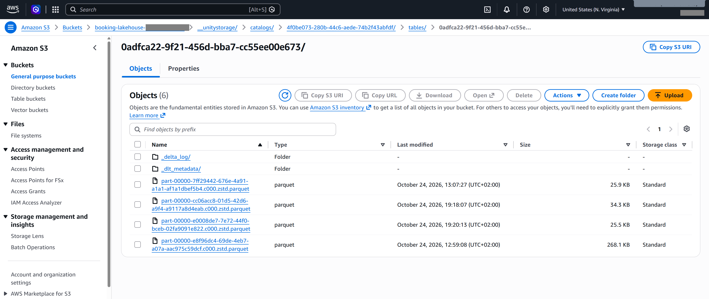
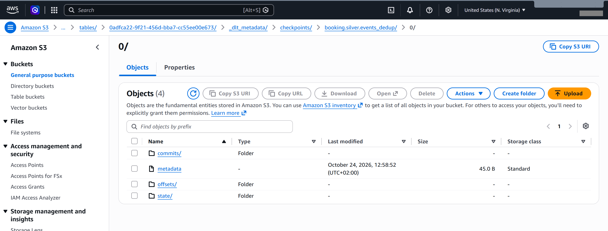
</p>

### 7. The dashboard

One AI/BI dashboard, four pages, deployed by the bundle and refreshed by the job.

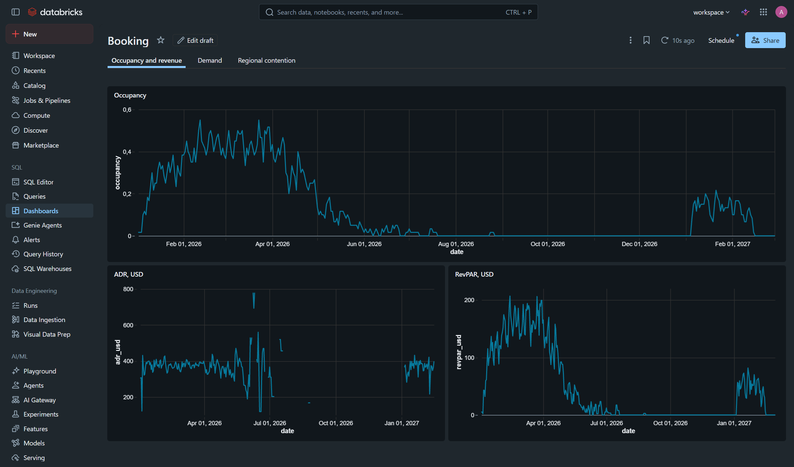

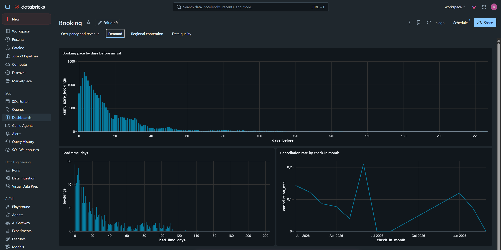

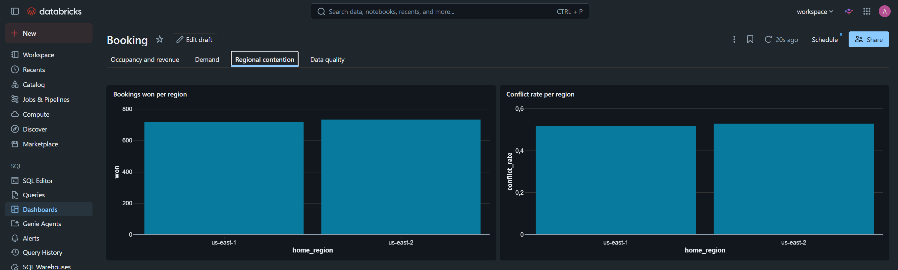

Both regions win about the same share of contested writes: the conflict rate was 54.6 % in
us-east-1 and 54.9 % in us-east-2 in run 2, and 51.6 % and 52.7 % in run 5. Neither region is
favoured.

## PII residency

`POST /guests` stores name, email and phone in `guests-us` (us-east-1) or `guests-eu`
(eu-central-1), chosen by the declared residence country. The booking store, the events, S3 and the
lakehouse carry only `guest_id` and the jurisdiction
([`test_pii_residency`](tests/integration/test_guests.py)). A guest who declares the wrong country is
stored by the declaration; this limit is documented, not solved.

## Platform

### Environment structure

One environment, `demo-prod`, laid out as `infra/live/demo-prod/<region>/<component>`, one
Terraform state per unit:

| Region | Components |
|---|---|
| us-east-1 | `store` (MRSC tables), `api`, `saga`, `stream`, `landing`, `guests_vault`, `k6`, `databricks_uc`, `mrsc` (race table) |
| us-east-2 | `api`, `saga`, `k6` |
| us-west-2 | `k6` (the MRSC witness is part of `store`) |
| eu-central-1 | `guests_vault` |

<p>
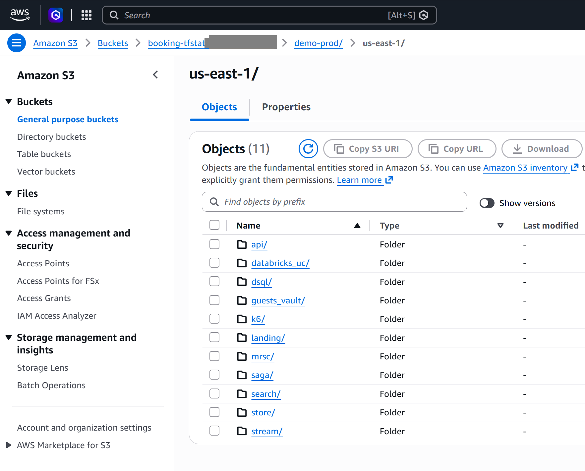
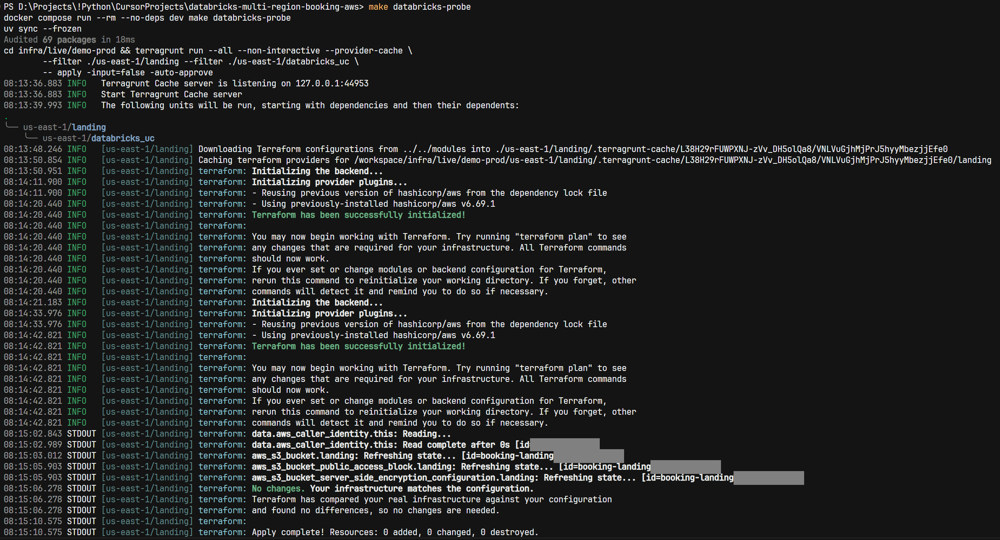
</p>

Persistent and free while idle: the Terraform state bucket, the GitHub OIDC roles, the $12 budget
alert, the dev image, the empty landing bucket, the empty race table, and the Databricks catalog,
pipeline, job and dashboard. Everything else is created by `make up` and destroyed by `make down`.
A session writes its expiry to SSM; a scheduled `reaper` workflow runs `make down` once it passes.

### CI and the cloud session

GitHub Actions runs the same Make targets a contributor runs, inside the same dev image, and
reaches AWS with OIDC, never with stored keys. The `cloud-session` workflow deploys to the
`demo-prod` environment, which needs a reviewer's approval; `make down` runs whatever happened
before it.

<p>
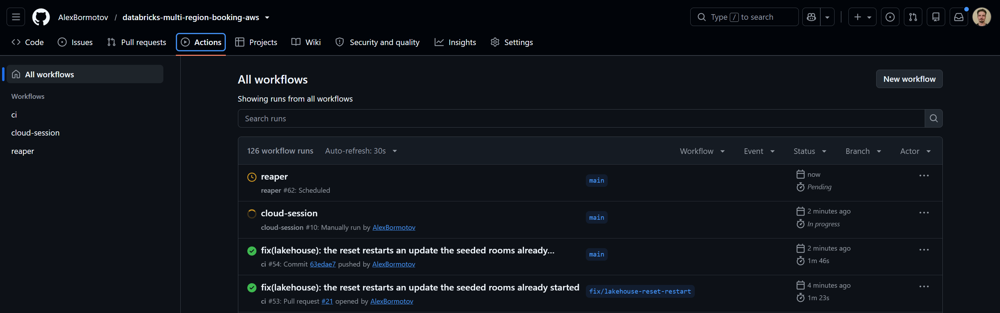
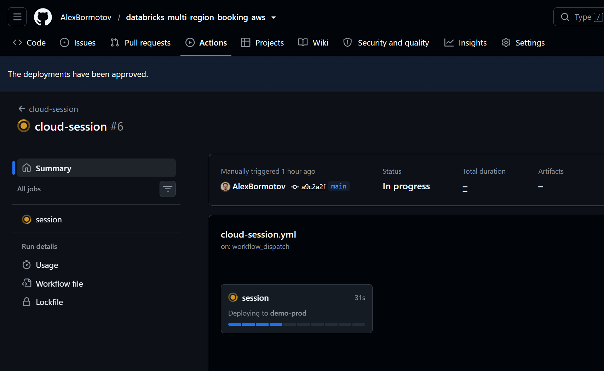
</p>

```sh
make lint test test-integration   # local, $0
make k6-local                     # the contention scenario against DynamoDB Local
make up && make demo && make down # a cloud session; CI runs the same targets
```

The owner's one-time steps, and how to run with or without Databricks, are in
[`docs/cloud-run.md`](docs/cloud-run.md).

## Cost

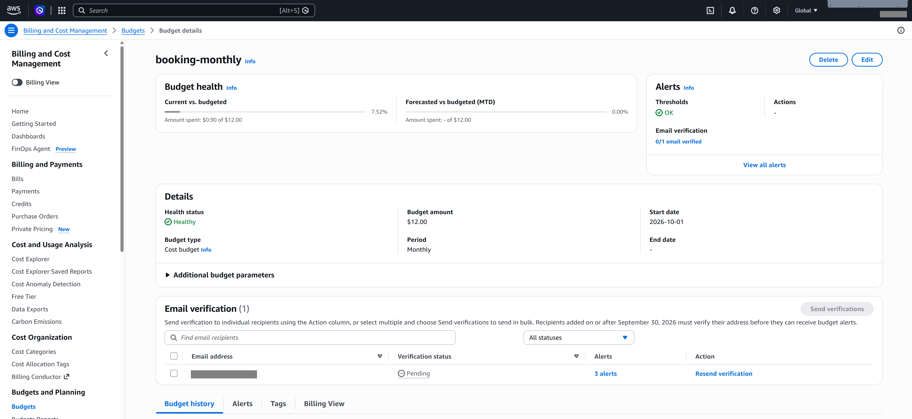

| Period | AWS, whole account | Databricks | Report |
|---|---|---|---|
| 2026-10-22, run 1 (three attempts that day) | $0.12 | none | [cost.json](docs/runs/2026-10-22-run-1/cost.json) |
| 2026-10-24, runs 2-5 (four sessions) | $0.43: S3 requests $0.25, Kinesis $0.07, KMS $0.06, EC2 spot $0.03, API Gateway $0.02, DynamoDB $0.02 | $7.33 at list price for 2026-10-23 to 24, paid from trial credits: SQL warehouse $4.22, pipeline $2.96, predictive optimization $0.11, networking $0.03, storage $0.01 | [cost.json](docs/runs/2026-10-24-cost.json); Databricks from the account usage dashboard |

Per session that is about $0.11 on AWS and $1.83 on Databricks, inside the $3-7 target. S3 is charged
for requests, not storage: Firehose, Auto Loader, Delta commits and the replay made 43,666
write-class requests that day, past the free tier. The KMS line is the account's IAM Identity
Center key, $0.065 a day whether a session runs or not; it is not part of the stack.

The target is $3-7 per session, most of it Databricks serverless.

## What the cloud runs taught

Each run found something local tests could not:

| Run | Found | Fix |
|---|---|---|
| 1 | Lambda concurrency of 10 per region throttled most attempts | k6 resends a throttled attempt with its `Idempotency-Key` ([#14](https://github.com/AlexBormotov/databricks-multi-region-booking-aws/pull/14)) |
| 2 (probe) | The trial metastore has no storage root, so the catalog could not be created | the catalog gets a bucket of its own ([#16](https://github.com/AlexBormotov/databricks-multi-region-booking-aws/pull/16)) |
| 2 | The API adds a trailing slash to the external location's URL, which made `//events/` | [#17](https://github.com/AlexBormotov/databricks-multi-region-booking-aws/pull/17) |
| 3 | Tables outlive `make down`; seeded traffic met the previous session's bookings in gold | the session resets the pipeline's tables ([#20](https://github.com/AlexBormotov/databricks-multi-region-booking-aws/pull/20)) |
| 4 | The seeded rooms reach S3 and start an update before the reset | the reset restarts it ([#21](https://github.com/AlexBormotov/databricks-multi-region-booking-aws/pull/21)) |
| 5 | k6 ran out of its 5-minute budget at 777 of 1000 answered attempts: 1 created, 776 conflicts, 0 errors | `maxDuration` raised to 8 minutes; not re-run |

## Decisions

- [ADR 1](docs/adr/0001-dsql-over-dynamodb.md): Aurora DSQL over DynamoDB global tables (superseded)
- [ADR 2](docs/adr/0002-dynamodb-mrsc-booking-store.md): DynamoDB MRSC as the booking store, events
  from its change stream
- [ADR 3](docs/adr/0003-exactly-once-in-delta.md): exactly once in Delta, dedup on `event_id`, then
  AUTO CDC by version
- [ADR 4](docs/adr/0004-pii-residency.md): guest PII stays in the vault of the guest's jurisdiction
- [ADR 5](docs/adr/0005-time-zones-and-currencies.md): nights are hotel-local dates, money is minor
  units in the hotel's currency
- [ADR 6](docs/adr/0006-semantic-search-dropped.md): the semantic search is dropped

The approved spec and plan are [`spec.md`](spec.md) and [`plan.md`](plan.md). They still describe
the search; ADR 6 supersedes those parts.
