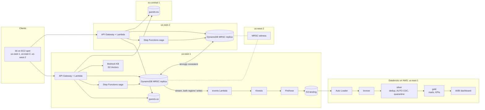

# Multi-region hotel booking on AWS, with a Databricks lakehouse

Hotel bookings accepted in two AWS regions at once, with zero double bookings: 1000 concurrent
attempts at the last room-night, from k6 in three regions, gave exactly one `201` and 999 `409`
([run 1](docs/runs/2026-10-22-run-1/k6.json)). Every booking change flows through a change stream
into a Databricks lakehouse (Auto Loader, Lakeflow Declarative Pipelines, Unity Catalog) for
occupancy and revenue analytics, with exactly-once into Delta. The whole stack comes up with
`make up` and goes away with `make down`; a full session costs cents on AWS.

| | |
|---|---|
| Transactional | API Gateway + Lambda (Python 3.13) in us-east-1 and us-east-2, DynamoDB global tables with multi-region strong consistency (MRSC), Step Functions saga |
| Analytical | DynamoDB Streams -> Kinesis -> Firehose -> S3 -> Auto Loader -> Lakeflow Declarative Pipelines (medallion, AUTO CDC, expectations) -> Unity Catalog -> AI/BI dashboard |
| Search | Bedrock Knowledge Base on S3 Vectors, filtered by live availability |
| Platform | Terraform + Terragrunt, GitHub Actions with OIDC, Databricks Asset Bundles, one dev container for CI and contributors |

## Status

| Part | Evidence |
|---|---|
| Booking core, saga, events, PII residency | 50 integration tests on DynamoDB Local, green in CI |
| Cloud run 1, AWS only (2026-10-22) | [workflow run](https://github.com/AlexBormotov/databricks-multi-region-booking-aws/actions/runs/39827590413), [artifacts](docs/runs/2026-10-22-run-1/): every demo step passed, `make down` completed, $0.12 for the day |
| Lakehouse | unit and end-to-end tests on local Spark; the cloud run on a Databricks workspace (run 2) is next |
| Semantic search | code and infrastructure deployed in run 1; the account's Bedrock model access is still pending with AWS, so the corpus ingestion and the `/search` step were switched off (`SEARCH=off`, see [cloud-run.md](docs/cloud-run.md)) |
| Demo video | to be recorded after run 2 |

## Architecture



The booking store is four DynamoDB tables replicated with strong consistency between us-east-1 and
us-east-2, with us-west-2 as witness. Guests' PII never enters it: it lives in a single-region table
chosen by the guest's jurisdiction. The stream exists only in us-east-1, where the tables were
created, and carries the writes of both regions.

## How a double booking is made impossible

One item per taken room-night, `room_night = <room_id>#<night>`, written with a conditional
`PutItem` (`attribute_not_exists(room_night)`, or the holder's hold expired more than 5 s ago).
With strong consistency across regions, two writers of the same key cannot both succeed; the loser
gets a failed condition, or a `ReplicatedWriteConflictException` that is retried with exponential
backoff and full jitter. A multi-night stay claims its nights in date order and releases them if
any night is taken ([`src/booking/service.py`](src/booking/service.py)).

The invariant check does not trust the claims: it scans the bookings themselves for two live
bookings of one room with overlapping stays ([`booking.store.violations`](src/booking/store.py)).

| Claim | Local evidence | Cloud evidence |
|---|---|---|
| 1000 concurrent bookings of one room-night, one winner | [`test_concurrent_same_room_night`](tests/integration/test_booking.py) | [k6.json](docs/runs/2026-10-22-run-1/k6.json): created 1, conflict 999, from three regions to both APIs |
| No overlapping live bookings afterwards | [`test_invariant_flags_overlap`](tests/integration/test_booking.py) | [invariant.json](docs/runs/2026-10-22-run-1/invariant.json): no violations, one booking on the contested night |
| Concurrent conditional writes from both regions: one wins, both replicas agree | [`test_mrsc_race`](tests/integration/test_mrsc_race.py) | [mrsc.json](docs/runs/2026-10-22-run-1/mrsc.json): 100 attempts, 1 won |
| Same `Idempotency-Key` replays, never books twice | [`test_idempotent_replay`](tests/integration/test_booking.py) | [traffic.json](docs/runs/2026-10-22-run-1/traffic.json): replay `200` |

Negative control: with the claim condition removed, `test_concurrent_same_room_night` produces many
`201`s and fails.

### First commit, not first click

The guarantee is "first write wins", not "first click wins". Two regions share no clock that orders
clicks, so a first-click rule could be neither enforced nor checked; the order of conditional writes
can be. In run 1 all three k6 instances started at one shared instant; the winning attempt came from
the instance in us-east-2.

### Payment after the hold expired

A booking is held as `pending` for a TTL while a Step Functions saga races a simulated payment
against a timer. Every write is conditioned on the booking's `version`. A payment that arrives after
the hold expired, or after another booking took over a night, leaves the booking `expired` and emits
`PaymentRefunded` ([`test_payment_after_expiry`](tests/integration/test_saga.py),
[`test_payment_after_takeover_is_refunded`](tests/integration/test_saga.py)). Confirmation first
removes the claims' expiry, then confirms the booking; a crash in between leaves the room blocked,
never sold twice.

### The last room from two regions

DynamoDB MRSC has no transactions, so a multi-night booking cannot claim its nights atomically. The
loser of a race may hold its earlier nights for milliseconds before it releases them; nobody is ever
confirmed on a night someone else holds. MRSC also has no TTL, so expiry is evaluated by every
writer at write time ([ADR 2](docs/adr/0002-dynamodb-mrsc-booking-store.md)).

## Events and exactly-once in Delta

Each change of a booking becomes one envelope on Kinesis with a name-based id: `uuid5(booking_id,
version)` for a state event, `uuid5(booking_id)` for the refund
([`src/booking/events.py`](src/booking/events.py)). Delivery is at least once; a redelivered change
repeats its id. Firehose partitions by the region that accepted the write.

In the lakehouse:

- bronze: Auto Loader, append only;
- silver: one row per `event_id` ([`test_dedup_collapses_duplicates`](tests/lakehouse/test_silver.py)),
  then `AUTO CDC ... SEQUENCE BY aggregate_version` restores per-booking order across regions
  ([`test_cdc_oracle_out_of_order`](tests/lakehouse/test_gold.py)); in the cloud the job compares it
  with an independent "latest version" query and fails on any difference;
- gold: room-night grain with occupancy, ADR, RevPAR, booking pace, lead time, cancellation rate and
  conflict rate by region ([`tests/lakehouse/test_gold.py`](tests/lakehouse/test_gold.py)).

Money is stored in minor units with the hotel's currency and converted to USD at the night's rate;
nights are hotel-local dates, and lead time is computed in the hotel's time zone
([`test_fx_per_night`](tests/lakehouse/test_gold.py),
[`test_lead_time_across_midnight`](tests/lakehouse/test_gold.py)).

### Expectation policy

| Layer | Policy | Why |
|---|---|---|
| bronze | `expect`: record, keep | bronze is the raw record; nothing is lost before it is understood |
| silver | `expect_all_or_drop` from one rule set; `quarantine_events` keeps every dropped row with the rule it broke | bad rows leave the marts but stay inspectable ([`test_quarantine_partition`](tests/lakehouse/test_silver.py)) |
| gold | `expect_or_fail`: no room-night has two confirmed bookings | a double booking in the marts means the facts are wrong; the update stops ([`test_gold_invariant`](tests/lakehouse/test_gold.py)) |

### Pipeline run mode

One serverless Lakeflow Declarative Pipeline, triggered, not continuous. The Lakeflow Job
`booking-refresh` runs it on file arrival in the landing prefix, at most every 5 minutes, then runs
the SQL checks (gold invariant, CDC oracle, row counts against the store) and refreshes the
dashboard ([`databricks/databricks.yml`](databricks/databricks.yml)). A triggered pipeline costs
nothing between bursts of bookings, and five minutes is fresh enough for occupancy and revenue.

## PII residency

`POST /guests` stores name, email and phone in `guests-us` (us-east-1) or `guests-eu`
(eu-central-1), chosen by the declared residence country. The booking store, the events, S3 and the
lakehouse carry only `guest_id` and the jurisdiction
([`test_pii_residency`](tests/integration/test_guests.py)). A guest who declares the wrong country is
stored by the declaration; this limit is documented, not solved.

## Environment structure

One environment, `demo-prod`, laid out as `infra/live/demo-prod/<region>/<component>`:

| Region | Components |
|---|---|
| us-east-1 | `store` (MRSC tables), `api`, `saga`, `stream`, `landing`, `search`, `guests_vault`, `k6`, `databricks_uc`, `mrsc` (race table) |
| us-east-2 | `api`, `saga`, `k6` |
| us-west-2 | `k6` (the MRSC witness is part of `store`) |
| eu-central-1 | `guests_vault` |

Persistent and free while idle: the Terraform state bucket, the GitHub OIDC roles, the $12 budget
alert, the dev image, the empty landing bucket and the empty race table. Everything else is created
by `make up` and destroyed by `make down`. A session writes its expiry to SSM; a scheduled workflow
runs `make down` once it passes.

## Running it

Everything runs inside the dev container; the host needs Docker and `make`.

```sh
make lint test test-integration   # local, $0
make k6-local                     # the contention scenario against DynamoDB Local
make up && make demo && make down # a cloud session; CI runs the same targets
```

The cloud session runs from the `cloud-session` workflow with a required reviewer. The owner's
one-time steps, and how to run with or without Bedrock and Databricks, are in
[`docs/cloud-run.md`](docs/cloud-run.md).

## Cost

| Session | AWS, whole account | Databricks | Report |
|---|---|---|---|
| Run 1, 2026-10-22 (three attempts that day) | $0.12 | none | [cost.json](docs/runs/2026-10-22-run-1/cost.json) |

The target is $3-7 per session, most of it Databricks serverless.

## Account limits met on the way

A new AWS account is not a default one, and the project adapts rather than waits:

- Aurora DSQL, the first choice, could not be created; the store moved to DynamoDB MRSC
  ([ADR 2](docs/adr/0002-dynamodb-mrsc-booking-store.md)).
- Lambda concurrency was 10 per region (raised to 40 so far). k6 resends a throttled attempt with
  the same `Idempotency-Key`, so all 1000 attempts reach the store; 4307 resends in run 1.
- Bedrock model access is not yet granted; search runs once it is.

## Decisions

- [ADR 1](docs/adr/0001-dsql-over-dynamodb.md): Aurora DSQL over DynamoDB global tables (superseded)
- [ADR 2](docs/adr/0002-dynamodb-mrsc-booking-store.md): DynamoDB MRSC as the booking store, events
  from its change stream

The brief is [`TASK.md`](TASK.md); the approved spec and plan are [`spec.md`](spec.md) and
[`plan.md`](plan.md).
